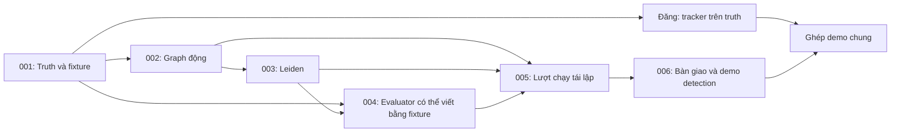

# Specs công việc Phúc — tuần 1

**Ngày lập:** 16/10/2026. **Owner:** Phúc. **Mốc nội bộ:** 20/10/2026; ngày 21/10 dự phòng, báo cáo 22/10 theo lịch repo.

Đây là bộ đặc tả để Phúc triển khai và các thành viên theo dõi được: đang làm gì, cần tạo ra gì, nghiệm thu thế nào và bằng chứng nằm đâu. Tài liệu được tổ chức sau khi đối chiếu nguồn chính thức trong [research.md](research.md). Định hướng kỹ thuật giữ theo [phân công Phúc–Đăng v1](../../PHAN-CONG-PHUC-DANG-TUAN-1.md).

**Hiện trạng:** mới chuẩn bị specs và task list; chưa thực hiện các task triển khai trong bộ này. Independent Leiden đã có trong repo, nhưng benchmark tổng hợp, evaluator và demo của Phúc vẫn cần triển khai/kiểm chứng.

## Mở file nào

| Bạn muốn biết | Mở |
|---|---|
| Phúc đang làm gì, đã xong gì, có vướng ai không | [tasks.md — bảng tiến độ và bằng chứng](tasks.md) |
| Tối nay bắt đầu việc nào | [plan.md — luồng tối thiểu](plan.md#1-luồng-tối-thiểu-tối-1610) |
| Input/output để Đăng đọc được | [contracts.md](contracts.md) |
| Yêu cầu và tiêu chí hoàn thành từng phần | Sáu spec bên dưới |
| Lý do chọn cách tổ chức này, nguồn đã đọc | [research.md](research.md) |

## Sáu phần việc

| Spec | Đầu ra có thể xem/kiểm tra | Mã phân công gốc | Cần Đăng để hoàn thành phần Phúc? |
|---|---|---|---|
| [PHUC-001 — Truth và fixture](001-truth-fixtures/spec.md) | Membership/events/links chuẩn stable/grow để tracker dùng ngay | P01 | Không; phản hồi schema được ghi riêng |
| [PHUC-002 — Sinh mạng động](002-dynamic-benchmark/spec.md) | Graph và ground truth đủ sáu sự kiện, có cấu hình/seed | P02, P05 | Không; Đăng cùng rà nhãn |
| [PHUC-003 — Chạy Leiden](003-leiden-detection/spec.md) | Membership dự đoán, diagnostics và reference | P03 | Không |
| [PHUC-004 — Đánh giá detection](004-detection-evaluation/spec.md) | AMI, coverage, số nhóm và thời gian | P04 | Không |
| [PHUC-005 — Lượt chạy tái lập](005-reproducible-runs/spec.md) | Development/evaluation riêng, manifest, bảng kết quả | P06 | Không; chưa bao gồm tracker |
| [PHUC-006 — Bàn giao và demo](006-handoff-demo/spec.md) | Gói bàn giao, notebook detection, phần ghép tracker được ghi riêng | P07 | Phần cá nhân không; demo chung cần tracker của Đăng |

Các task, hạn và trạng thái chỉ cập nhật tại [tasks.md](tasks.md), không duy trì thêm bảng phần trăm ở README hoặc hai kế hoạch cũ.

## Quan hệ phụ thuộc

Mũi tên là phụ thuộc đầu ra để **nghiệm thu**, không buộc chờ toàn bộ spec trước mới viết code. Ví dụ evaluator có thể phát triển bằng fixture trước khi detector xong; Đăng bắt đầu tracker ngay khi có fixture truth.

## Quy tắc theo dõi trong nhóm

1. Chọn một task trong `tasks.md`, đổi `[TODO]` thành `[DOING]`; giới hạn một task đang làm chính để dễ theo dõi.
2. Khi có đầu ra, ghi bằng chứng vào bảng task tương ứng: code/commit/PR nếu có, lệnh, kết quả kiểm tra, run ID và artifact.
3. Chỉ đánh `[x] ... [DONE]` khi đạt tiêu chí task; lỗi kiểm tra phải được sửa hoặc công khai giới hạn theo spec.
4. Nếu nhờ review, dùng `[REVIEW]`. Reviewer đề xuất là Đăng cho dữ liệu/detection; chưa có nghĩa Đăng đã nhận review.
5. Nếu thực sự không thể tiếp tục task đang làm, dùng `[BLOCKED]`, ghi thiếu gì và bước mở chặn. Phụ thuộc dự kiến ở task tương lai vẫn để TODO.
6. Bảng trạng thái spec ở đầu `tasks.md` là bản tóm tắt từ checklist trong chính file đó; đối chiếu checklist khi có lệch.
7. Commit/PR nên ghi task ID, ví dụ `PHUC-004-T03: compute AMI with explicit coverage`. Không cần một commit cho mọi checkbox.

Tất cả task DONE là hoàn thành phần triển khai được giao, không mặc nhiên là người khác đã review, nhận bàn giao hoặc thí nghiệm có kết quả tốt. Ghi xác nhận người nhận riêng, không tự đánh dấu thay họ.

## Phạm vi và thay đổi

- Bộ này chỉ đặc tả tuần 1 của Phúc; tracker/F1 sự kiện của Đăng là giao diện phối hợp, không chuyển thành task Phúc phải viết thay.
- Không yêu cầu cài Spec Kit CLI, tạo issue online hoặc công cụ quản lý mới để bắt đầu.
- Dùng `spec.md` cho yêu cầu, `plan.md` cho cách làm, `tasks.md` cho tiến độ. Đây là cách rút gọn tham khảo Spec Kit, không khẳng định đã cài hay chạy workflow Spec Kit.
- Ngưỡng và semantics tracking giữ theo phân công v1. Nếu đổi, cập nhật phiên bản nguồn và contract liên quan trước lượt đánh giá mới.
- Artifact lớn giữ trong `artifacts/`; phần báo cáo được chọn, dữ liệu tổng hợp nhỏ và docs cần được review trước khi chia sẻ qua Git. Không đưa dữ liệu/user Reddit vào fixture giả lập.

## Đưa lên GitHub để các bạn cùng theo dõi

Thành viên có quyền repo dùng link nhánh/commit/PR chứa bộ tài liệu này để đọc README, mở task list và xem thay đổi. Chọn đúng nhánh chứa tài liệu nếu chưa merge vào main. Việc chia sẻ qua Git không tự tạo GitHub Issues/Projects hoặc đồng bộ trạng thái; tiến độ vẫn cập nhật tại `tasks.md`.

Nếu nhóm dùng GitHub Issues sau này: mỗi spec tương ứng một issue, gắn owner Phúc, link spec và task list thay vì chép thêm checklist thứ hai. Chỉ bổ sung dependency/reviewer sau khi xác nhận với người liên quan. Dùng một nơi làm nguồn trạng thái chính; v1 này chọn `tasks.md`.
