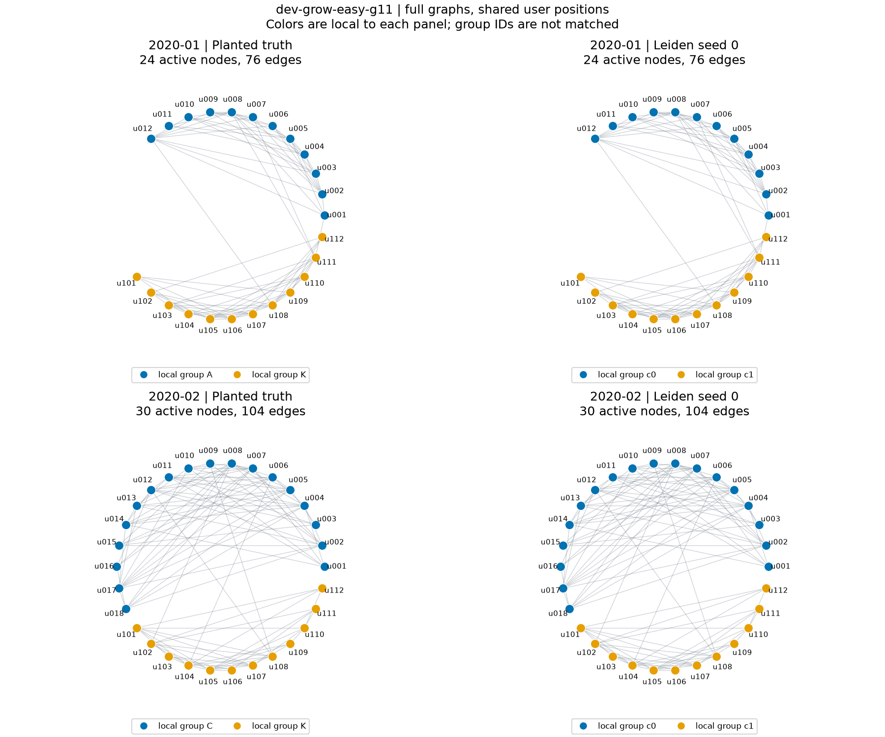
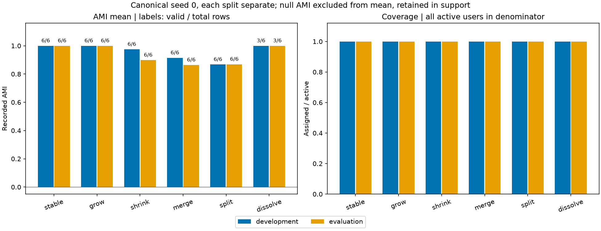

# Bằng chứng PHUC-006-T03 — notebook detection tổng hợp

**Trạng thái:** DONE; PHUC-006 **3/6**, tổng Phúc **33/36**. Owner Phúc, ngày 19/10/2026. Nhánh `feat/phuc-006-handoff-demo`, base `c2867f1`, [PR #11](https://github.com/TamNgx179/reddit-community-evolution/pull/11).

## Vừa làm gì và dùng để làm gì

Tạo [01_synthetic_demo.ipynb](../../../../notebooks/detection_tracking/01_synthetic_demo.ipynb) gồm **17 cells, 8 code cells**, và [reporting/synthetic_demo.py](../../../../src/reddit_sna/reporting/synthetic_demo.py). Notebook import module đã cài, không sửa `sys.path`, không cài thư viện trong cell, không gọi generator/Leiden/AMI. Mọi số liệu đọc từ T02 delivery đã pin manifest/hash và consumer T01 kiểm tra nguyên hai runs.

Notebook hiển thị cấu hình, producer environment, AMI/coverage/support riêng split/seed, graph đầy đủ của grow seed 11, seed diagnostics và recorded timing có scope. Output mới giữ **4 hình PNG + SVG**, **4 CSV** (metrics, summary, summary view, timing), `figure-sources.json` và complete metadata cuối: **14 files/run**. Plot nguồn có relative input paths/hashes, canonical seed 0; thiếu AMI giữ null/reason/support, không thay bằng điểm giả.

Đây là replay kết quả detection đã xem/đã khóa, không phải lượt scientific evaluation mới hoặc kết quả Reddit. Dataset minh họa `dev-grow-easy-g11` theo ví dụ T02, không có bước tìm seed/case điểm cao nhất. Bảng tổng hợp vẫn dùng toàn bộ recorded runs.

## Kết quả thật và hình xem trước

- Toàn lịch **36 dataset/72 snapshot/216 metrics**, **42 summary rows**, **198 AMI valid/18 null**. Mỗi split/seed có 33 valid/3 null; canonical mean development **0.955879927**, evaluation **0.933116751**, coverage 1.0.
- Grow seed 11 vẽ **toàn bộ 24/30 active nodes, 76/104 edges** hai tháng, cùng vị trí user qua panels; truth/prediction có ID và màu cục bộ, không dùng màu để matching. AMI/coverage của hai snapshot minh họa đều 1.0, không thay kết luận toàn lịch bằng ví dụ này.
- Hình AMI case ghi valid/total ngay trên cột, dissolve **3/6** cho mỗi split ở seed 0. Mean dissolve 1.0 chỉ là trên ba dòng hợp lệ, ba dòng còn lại null do truth constant.
- Timing có **8 rows**: ba stage wrappers và total run cho mỗi split. Detection bao gồm cả ba seeds; không chia hoặc nhân thành timing từng seed, không trộn thời gian vẽ notebook với runtime producer. Peak memory vẫn chưa đo.

Nguồn graph: `runs/development/inputs/source/dev-grow-easy-g11/{snapshots,truth}` và canonical CSV trong `inputs/detected/...`, bảy file nguồn được hash trong `figure-sources.json`.

Nguồn summary: hai `runs/<split>/evaluation/detection_summary.csv`. Source ledger và SHA-256 từng PNG/SVG: [figure ledger 4 dòng](PHUC-006-T03-figure-ledger.csv). [Seed summary 6 dòng](PHUC-006-T03-seed-summary.csv), [timing 8 dòng](PHUC-006-T03-timing.csv).

## Kiểm tra đã chạy

- [14 unit tests mới](../../../../tests/unit/test_synthetic_demo.py) kiểm tra null/điểm âm/nonfinite/support, canonical không đổi theo điểm, timing scopes, escaped HTML, delivery pin/corruption/path, full node/edge display và isolate, null bar là gap, no-overwrite/overlap và partial publication.
- **39/39 targeted tests PASS**, 0 skip/failure/error, **19.257s wall** ở lượt cuối: 14 tests mới + 25 independent handoff consumer tests. Lượt đầu 39/39 cũng đạt; chạy lại sau sửa layout. Không chạy lại full repo suite.
- Hai **fresh-kernel smoke runs** trong venv hiện có, cwd `notebooks/detection_tracking/`, argv trỏ đúng `.venv/Scripts/python.exe`: đều **8/8 code cells**, execution count 1→8, không cell error, **4 inline PNG outputs**. Smoke 001 **58.303s**; final 002 **40.532s**. Chênh thời gian không phải benchmark tốc độ; scientific data không được tính lại.
- Visual review phát hiện legend của hình quality lượt 001 che một support label; chuyển xuống ngoài axes và giữ nguyên 001, chạy 002 vào output mới. **Bốn CSV hai lượt giống từng byte**; network/seeds/timing PNG giống byte, quality PNG đổi do layout. Đã xem đủ bốn PNG cuối; không còn legend che valid counts.
- Audit độc lập đọc lại exported CSV so với nguyên source CSV: đủ 216 metric keys/42 summary rows, không mất null/seed. Đối chiếu output hashes/sizes, 4 figure sources, notebook nguồn không outputs, metadata source/module hashes và ZIP bytes.

Môi trường: CPython **3.12.6**, nbformat **5.11.1**, nbclient **0.11.0**, ipykernel **7.4.0**, matplotlib **3.11.2**, numpy **2.5.4**. Không cài/thay dependencies trong T03. Kernel 001 tự shutdown khi launcher kết thúc; launcher 002 yêu cầu cleanup rõ ràng. Đây là smoke ở môi trường hiện có; **formal clean install/replay T05 chưa nghiệm thu**.

## Đầu ra, source và bảo toàn

- Final output: `artifacts/detection-tracking/phuc-006-t03-notebook-002/`; giữ nguyên `-001/` để đối chiếu layout.
- Final executed notebook: `artifacts/verification/phuc-006-t03-001/smoke-002/01_synthetic_demo.executed.ipynb`. Bản trong Git cố ý không có output cache.
- Proof `artifacts/verification/phuc-006-t03-001/` gồm baseline/plan, builders/launchers, tests/logs/results hai lượt, source snapshots (có cả first-smoke module khớp hash cũ), hai output copies, figure review/source ledger, audit và **ZIP T02 nguyên byte** để tái lập input.
- Proof ZIP `artifacts/verification/phuc-006-t03-001.zip`: **54 files, 3.251.088 byte**, CRC và từng entry đã đối chiếu. SHA-256 **`9703f5d027142aac815d13ff18a6b3847c1373d3f6965a5080874ad8f9607b3c`**. [Reference](PHUC-006-T03-notebook-reference.json) giữ source notebook/module hashes, outputs và archive.
- **9.340 artifact cũ, 101 source/config/test/guide files cũ giữ nguyên hash**, **42 frozen source files không đổi byte**. Không sửa consumer T01, producer/config/freeze, hướng dẫn T02 hoặc ZIP đã chuẩn bị cho Đăng. Reporting helper mới nằm ngoài frozen runtime; benchmark replay vẫn theo baseline `09623f1`/frozen source, notebook chỉ đọc output.

Audit hoàn tất **19/10/2026 13:18:18 +07**. Full figures/executed notebooks/proof ZIP local bị ignore; source notebook/module/tests, hai PNG preview và ba CSV nhỏ/reference/evidence theo Git.

## Mở notebook và việc còn lại

Chọn kernel `.venv/Scripts/python.exe` trong VS Code/Jupyter, mở notebook rồi Restart Kernel → Run All. Input mặc định là thư mục T02 đã giải nén trên máy Phúc; máy khác đặt `REDDIT_SYNTHETIC_BUNDLE` tới root gói. Có thể đặt `REDDIT_SYNTHETIC_DEMO_OUTPUT` tới output mới trong repo `artifacts/`; không dùng lại `-001`/`-002`. [Hướng dẫn notebook](../006-handoff-demo/README.md#notebook-detection--t03).

FR02/T03 và AC03 phần bảng/hình có nguồn đạt. AC02 đã có smoke fresh-kernel ở venv hiện tại, formal environment gate vẫn còn T05. **Tiếp theo T04:** phân tích case khó/null từ graph/truth/prediction, sau đó T05/T06. Người dùng báo đã nhắn Đăng; chưa xác nhận Đăng đọc/nhận ZIP, chưa có tracker/F1/confusion hoặc demo chung. Không đổi các mốc EXT-D/PAIR-DEMO thành DONE.
