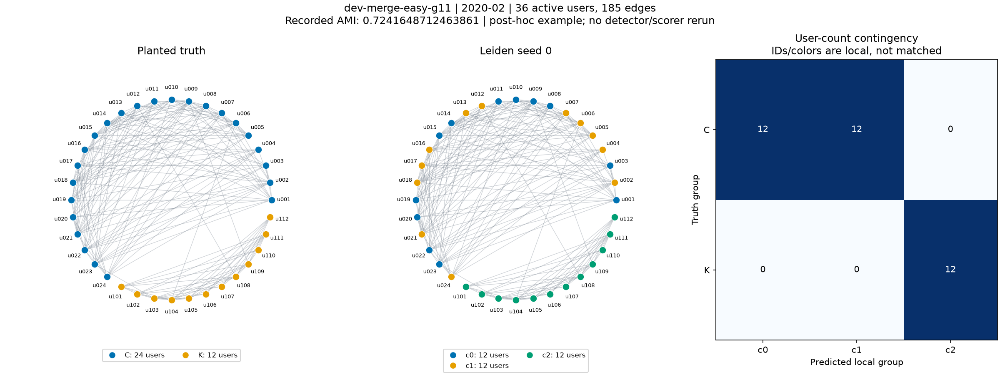
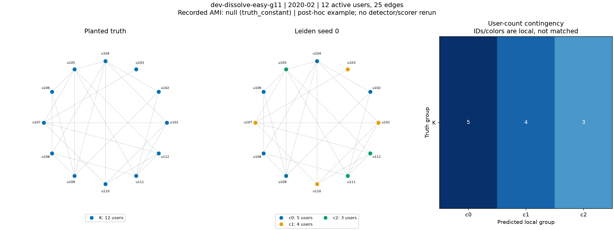

# PHUC-006-T04 — giải thích case khó và AMI null

**DONE**, PHUC-006 **4/6**, tổng Phúc **34/36**; owner Phúc, 19/10/2026. Base `a38ddec`, nhánh `feat/phuc-006-handoff-demo`, [PR #11](https://github.com/TamNgx179/reddit-community-evolution/pull/11). **FR04/AC04 đạt**; T05 formal clean install/replay và T06 chốt bàn giao còn riêng.

## Vừa làm gì

Thêm [synthetic_cases.py](../../../../src/reddit_sna/reporting/synthetic_cases.py) và mục 7 của [notebook](../../../../notebooks/detection_tracking/01_synthetic_demo.ipynb). Đọc graph, truth, canonical membership và AMI/coverage đã lưu trong gói T02; dựng hai hình đầy đủ truth–prediction–bảng đếm user, CSV đối chiếu và cạnh trong/giữa các nhóm. [Guide bàn giao mục 10](../../../PHUC-DANG-WEEK1-HANDOFF.md#10-bổ-sung-phân-tích-detection--phuc-006-t04-19102026) giải thích cùng các kết quả để Đăng đọc được.

Chọn ví dụ **sau khi xem kết quả (post-hoc)** trong **development, detector seed 0**: AMI hợp lệ thấp nhất; hòa thì dataset ID/tháng tăng dần. Có **2 dòng hòa điểm thấp nhất**, chọn `dev-merge-easy-g11/2020-02`. Case null chọn dòng đầu theo dataset/tháng. Không chọn từ evaluation, không đổi gamma/seed/policy hoặc chạy lại generator/Leiden/AMI; ví dụ không phải một test set mới và không đại diện toàn suite. Pair counts/densities là mô tả bổ sung của input cũ, không phải AMI/event-F1 mới.

## Case merge: coverage đủ nhưng nhóm vẫn khác đáp án

`dev-merge-easy-g11`, tháng `2020-02`, generator **11**, detector **0**, gamma **1**: **36 user, 185 cạnh**. Truth có `C=24, K=12`; detector có `c0=c1=c2=12`.

| Truth \ detector | c0 | c1 | c2 |
|---|---:|---:|---:|
| C | 12 | 12 | 0 |
| K | 0 | 0 | 12 |

Đây là nhóm C bị chia nhỏ thành hai phần 12 người, nhóm nền K giữ nguyên. Trên **630 cặp user**, **144 cặp cùng truth nhưng khác detector**, **0 cặp khác truth nhưng cùng detector**. Đây là khác biệt phân hoạch tại một snapshot, chưa phải tracker dự đoán sự kiện split. AMI ghi sẵn **0.7241648712463861**, coverage **1.0**: đủ user có nhóm chưa có nghĩa tìm đúng nhóm.



Đếm cạnh: c0 **46/66**, c1 **42/66**, c2 **41/66** cạnh trong nhóm; giữa c0–c1 **52/144**, c0–c2 và c1–c2 mỗi cặp nhóm **2/144**. Mật độ nội bộ hai phần của C cao hơn mật độ giữa hai phần trong graph này. Đây là mô tả cấu trúc quan sát được; **chưa chứng minh nguyên nhân tối ưu của Leiden hoặc cho phép tuning sau khi xem điểm**. Không nhầm local IDs/màu với matching truth–detector.

## Case dissolve: null không có nghĩa khớp hoàn hảo

`dev-dissolve-easy-g11`, tháng `2020-02`, generator **11**, detector **0**: **12 user, 25 cạnh**. Truth chỉ có `K=12`; detector chia thành **5/4/3**. Có **47/66 cặp** cùng truth bị tách, dù coverage **1.0**.



Theo policy đã khóa `synthetic-ami-v1`, AMI giữ **null**, status **`degenerate_partition`**, reason **`truth_constant`**. Không điền bằng 0/1, không gọi là kết quả hoàn hảo và không che khác biệt nhóm bằng cách bỏ hình/bảng. Các bảng summary toàn lịch giữ nguyên **198 valid/18 null** và reasons/support.

## Nguồn và file đã lưu

Run development `phuc-005-t05-development-001`, manifest SHA-256 `34364c98519e394af8541b9093a78899469239856f583d01608ec8848ade4e8e`. Bundle T02 manifest pin `7083d08df2d85eb6feacc874b5655f8759a07efb7c732d13947ad198ff0bceaf`.

Paths từ `runs/development`: `inputs/source/<dataset>/snapshots/2020-02/{R,nodes}.csv`, `inputs/source/<dataset>/truth/membership.csv`, `inputs/detected/<dataset>/memberships/2020-02/membership-seed0.csv`; score/policy ở `evaluation/{detection_metrics.csv,ami-policy.json}`. Mỗi case có sáu input paths/hashes trong `analysis.json` và `figure-sources.json`; source reference đầy đủ nằm trong metric gốc. Không dùng đường dẫn tuyệt đối producer cũ để tìm CSV.

Các file nhỏ có trong Git:

- [Case summary](PHUC-006-T04-case-summary.csv), [merge contingency](PHUC-006-T04-hard-contingency.csv), [dissolve contingency](PHUC-006-T04-null-contingency.csv).
- [Merge edge blocks](PHUC-006-T04-hard-edge_blocks.csv), [dissolve edge blocks](PHUC-006-T04-null-edge_blocks.csv), hai PNG preview phía trên.
- [Reference/checksum](PHUC-006-T04-case-analysis-reference.json) ghi source notebook/helper/guide, proof ZIP, kiểm chứng và giới hạn.

Full output **local**, `artifacts/` bị Git ignore:

| Đường dẫn từ root repo | Nội dung |
|---|---|
| `artifacts/detection-tracking/phuc-006-t04-notebook-001/` | 14 files replay bốn hình cũ, full 216 metrics/42 summary/8 timing, provenance/metadata |
| `artifacts/detection-tracking/phuc-006-t04-notebook-001-cases/` | **12 files**: hai PNG/hai SVG, năm CSV, analysis JSON, figure sources và metadata riêng |
| `artifacts/verification/phuc-006-t04-001/` | Executed notebook, commands/scripts/logs/tests, raw CSV audit, baseline, source snapshot, T02 ZIP nguyên byte và proof inventory |
| `artifacts/verification/phuc-006-t04-001.zip` | **51 files, 3.288.050 byte**, CRC và bytes từng entry đã xác minh; SHA-256 `6d017b9efcb60d35ff44c42cfe378297b4292a132b52e0a2fc09226da7a97152` |

Hai thư mục output cùng cấp, có metadata/inventory riêng; không thêm file phân tích vào output T03 đã niêm bằng chứng. ZIP T02 giữ nguyên SHA `e1a611092a8273b30570abdb4f6810ef9e07a0264ab07f0ce69ce4bce3880a14`. Guide trong ZIP vẫn là T02; `guide_sha256` trong reference T02 là **hash lịch sử của guide trong ZIP**. Guide Git hiện nối thêm mục 10, hash mới ghi ở reference T04; phần guide T02 vẫn nguyên byte ở đầu file. Không thay reference cũ để giả rằng ZIP có phân tích mới.

## Kiểm chứng đã chạy

Python **3.12.6**, matplotlib **3.11.2**, numpy **2.5.4**, venv hiện có. Lệnh test từ root:

```powershell
& .\.venv\Scripts\python.exe -m unittest tests.unit.test_synthetic_cases tests.unit.test_synthetic_demo tests.unit.test_synthetic_handoff -v
```

Harness dùng cùng ba modules với unittest runner, lưu `tests.log`/`tests-result.json`: **51/51 PASS**, **0 skip/failure/error**, **27.778s wall**. Bao gồm **12 tests mới**: deterministic selection/tie/seed/split, không bịa null, null/status, label rename/order, pair errors, isolate, edge denominators, invalid graph/keys, full plot user/edge counts, no-overwrite và failed publication.

Notebook chạy bằng nbclient từ cwd thư mục notebook, kernel mới trỏ `.venv/Scripts/python.exe`, cleanup kernel tường minh: **21 cells/10 code cells**, execution counts **1→10**, **0 cell error**, **6 inline PNG**, **53.075s**. Đây là smoke trong môi trường hiện có, **không phải clean install T05**. Source notebook trong Git không cache output hoặc sửa `sys.path`/cài package trong cell.

Audit stdlib độc lập không import helper mới, đọc raw CSV theo inventory: đếm lại node/edge/contingency/edge densities, pair errors bằng công thức tổ hợp độc lập, đối chiếu metric/reference và sáu input hashes/case. Bốn CSV replay và bốn PNG cũ **giống byte T03**, đủ 216 metric/42 summary rows; không mất null hoặc seed/split. Đã xem hai PNG mới, labels/legend/contingency đọc được. **9.426 artifact cũ và 42 frozen source files giữ nguyên byte**; configs, consumer và reporting T03 không đổi. Audit nguồn trước khi cập nhật các tài liệu trạng thái; spec/task board sau đó được sửa có chủ đích.

Không chạy full repo suite, cài môi trường mới hoặc scientific evaluation mới trong T04. Các chỉ số không phải kết quả Reddit, forecast, event-F1 hay nghiệm thu tracker. Phúc báo đã nhắn Đăng; receipt/đọc ZIP, tracker và demo cặp vẫn pending. **Tiếp theo PHUC-006-T05**; phần đó làm độc lập được.
