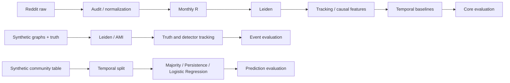

# Week 1 Report — Reddit Community Evolution

**Team:** Tâm, Thanh, Phúc, Đăng, Trâm, Anh. **Work period:** October 15–21, 2026. **Scheduled presentation:** October 22, 2026. This report documents the responsibilities, methods, execution evidence, and limitations of all three pairs. Attendance, presentation delivery, and instructor assessment require separate evidence.

> Integration verified on October 21, 2026: all three demos and four notebooks completed; 558/558 tests passed with no skips. The Git bases were main `b17f005` and the Phúc–Đăng branch `ff15259`; pre-commit runs recorded source hashes and working-tree state. These are descriptive baseline results, not certification of an unseen test or a maximum grade.

## 1. Objective and scope

The Week 1 requirement is to **complete an end-to-end baseline prototype, from input data to evaluation results**. Three independent pairs have their own inputs, execution paths, and outputs, without waiting for another pair's artifacts.

| Pair | Week 1 validation question | Input | Final output |
|---|---|---|---|
| Tâm–Thanh | Can the core workflow run from Reddit data through forecasting and evaluation? | 15 Reddit corpora; 2015 pilot | Membership, algorithmic labels, features, predictions, metrics, and diagnostics |
| Phúc–Đăng | Where do detection and tracking succeed or fail against known answers? | Synthetic dynamic networks with ground truth | AMI/coverage, event metrics, mappings, confusion matrices, and failure cases |
| Trâm–Anh | Do temporal baselines and evaluation behave correctly? | Synthetic community–month table with an explicit generation mechanism | Splits, Majority/Persistence/Logistic Regression, predictions, and evaluation |

The three workflows address different tasks and populations; their scores do not support a direct ranking of the pairs. Full HeTCo, original GED, the T layer, multislice/consensus, and B2/B5 are beyond the required Week 1 baseline scope.

## 2. Responsibilities and contributions

| Member | Assigned scope represented in the source | Technical deliverables |
|---|---|---|
| **Tâm** | Repository/environment, Reddit auditing and normalization, R graphs, provisional Independent Leiden, provenance, validation, and core integration | `data/`, `graphs/`, `detection/leiden.py`, preparation, core notebooks, and reproducibility instructions |
| **Thanh** | Jaccard/GED-adapted tracking, current and historical features, t→t+1 labels, basic forecasting | `tracking/ged.py`, core Jaccard API, `features/`, `pipelines/forecast.py`, metrics/predictions |
| **Phúc** | Six-event generator, graphs/truth, Leiden, AMI/coverage, protocol/freeze, synthetic handoff | `benchmarks/`, detection adapter, `evaluation/detection.py`, source runs, notebook/case analysis |
| **Đăng** | Membership adapter, Jaccard tracker, evaluation-only truth–detector mapping, event metrics | `tracking/membership.py`, `track()`, `evaluation/tracking.py`, predictions/confusions/diagnostics |
| **Trâm** | Temporal synthetic table, Majority/Persistence, Logistic Regression, model/prediction export | `benchmarks/community_table.py`, `models/`, generation/baseline stages of the prediction pipeline |
| **Anh** | Sample/availability validation, temporal splitting, leakage checks, metrics/confusions, interpretation | `evaluation/sample_checks.py`, `splits.py`, `metrics.py`, evaluation stages of the prediction pipeline |

Integration preserves the original algorithms and contributions while adding dependencies/status checks, rebuild paths, reporting, and compatibility tests. This table describes responsibility rather than authorship of every line or participation in class. The repository owner confirmed that invitations were sent to all five teammates; actual acceptance and access have not been independently verified.

## 3. Architecture and independence



The workflows use separate configurations and outputs. Shared code is organized by function under `src/reddit_sna/`; notebooks call package APIs instead of copying algorithms. Each run has a new identifier, configuration, and hashes. Failed runs are recorded as failures and cannot overwrite earlier runs.

## 4. Methods by pair

### 4.1. Reddit core — Tâm and Thanh

1. Check ZIP CRC/SHA-256 and schema; normalize UTC/IDs, handle duplicates, and apply the cutoff in SQLite. Preserve pre-pilot metadata for parent lookup without counting all such metadata as pilot activity.
2. A directed edge represents comment author → parent author, assigned to the comment month, provided the parent is not in the future. R combines both directions. Remove self-replies and invalid authors while auditing exclusion reasons.
3. Retain active-author/endpoint/isolate counts to explain coverage; partition only endpoints. `node_order.csv` uses a causal record anchor so detector behavior does not depend on ID allocation order when the cutoff changes.
4. Run Independent Leiden per month with weighted RBConfiguration, gamma 1, and seeds 0/1/2; the first seed is canonical. Modularity and seed ARI are diagnostics, not measures of social correctness.
5. The GED adaptation uses overlap and internal weighted-degree importance; it is not original GED. Preserve unresolved reasons rather than forcing every transition into a supervised label.
6. Features use information available through t. History comes from t−1→t, never t→t+1. Split by **label month** and fit the scaler/model on training data. Majority and Logistic Regression use the same eligible population.

The `transitions()` API retains Jaccard 0.25 and exact size comparisons. Its distinction from the synthetic tracker remains explicit to avoid silently changing core pseudo-labels or references during integration.

### 4.2. Synthetic detection/tracking — Phúc and Đăng

The generator provides known memberships, events, and links for stable, grow, shrink, merge, split, and dissolve. Development seeds are 11/12/13; evaluation seeds are 101/102/103. Each split contains 18 datasets and 36 snapshots; detector seeds 0/1/2 produce 108 units per split. The current regime is easy, with p_in=0.50 and p_out=0.02.

AMI evaluates detection partitions on an aligned population; coverage and null reasons are retained. Constant truth partitions may make AMI uninformative under the declared policy. Null values are not replaced with zero or one.

The `track()` tracker uses Jaccard ≥0.30, 10% size tolerance, and split-before-merge precedence. Route A uses ground-truth membership. Route B uses detected membership, followed by one-to-one greedy Jaccard source mapping **in the evaluator**. Ground truth does not inform tracker decisions. Outputs retain unmatched truth, extra detector sources, per-class support, and confusion matrices. Mean-dataset macro-F1 and pooled macro-F1 are distinct aggregation conventions.

The new rebuild path runs development → source/version freeze → evaluation in an isolated workspace, then tracking and reporting. Because the recipes have already been inspected, this freeze establishes local engineering order; **it does not make evaluation an independent unseen test**. Legacy T02 replay preserves its original pins. Hashes are not rewritten to manufacture retrospective evidence for Đăng.

### 4.3. Synthetic forecasting table — Trâm and Anh

The community–month table includes labels, current/historical features, and a fixed seed. Entire label-month groups are assigned to training, validation, or test. Final rows without future labels are counted separately and excluded from supervised samples.

Majority predicts the most frequent training class. Persistence repeats the previously observed event, falling back to Majority when history is insufficient. Logistic Regression uses numeric features and a training-fitted scaler, with fallback under the missing-feature policy. B4 is not HeTCo, and its design does not imply that it should outperform Persistence under every generator.

Evaluation checks sample keys, label availability, splits, and predictions before exporting `macro_f1` over classes present in truth, `macro_f1_six` over all six fixed classes, balanced accuracy, per-class metrics, and confusion matrices. The F1 conventions can differ when classes are absent. Reporting recomputes metrics from predictions before plotting.

## 5. Results and reproducibility

### 5.1. Integration runs

| Workflow | New integration run | Status |
|---|---|---|
| Core | `core/week1-group-core-001` | Complete; 83.325 seconds wall time |
| Detection/tracking | `detection-tracking/week1-group-synthetic-001` | Complete; 111.155 seconds wall time |
| Prediction | `prediction/week1-group-prediction-001` | Complete; 7.277 seconds wall time |

Paths above are relative to `artifacts/`. Runtime artifacts and annotation cases remain local; the repository contains source, instructions, and this report. Core notebooks retain output snapshots authorized for publication by the owner. Synthetic notebook source is published; separately executed copies remain in the local acceptance record.

### 5.2. Reddit core — verified integration replay

The new run uses graphs/memberships from `core/week1-demo-input`, produced by a previously verified raw scan covering all 15 corpora. This integration run **does not rescan raw data**. Both saved models were reloaded and reproduced every prediction. Six samples/features/labels/splits/predictions/metrics files are byte-identical to the earlier raw demo outputs.

| Metric | Result |
|---|---:|
| Eligible samples | 1,333 |
| Excluded source transitions | 732 |
| Train | 762 |
| Test | 571 |
| Majority: six-class macro-F1 | 0.159671533 |
| Logistic Regression: six-class macro-F1 | 0.360540447 |

There are 2,320 feature rows and 2,065 source transitions; the 732 exclusions represent 35.45%. Stable has no test support, while dissolve accounts for 525/571 samples. Logistic Regression recall for grow and merge is zero. Aggregate scores must be interpreted alongside failed classes and excluded populations.

### 5.3. Synthetic detection and event tracking — fresh source rebuild

Both splits were rebuilt from versioned configuration without requiring the historical T02 ZIP. Together they contain 36 datasets, 72 snapshots, and 216 detector units. Across all three detector seeds, 198 AMI values are valid and 18 are null under the declared policy; nulls remain null.

| Split | Canonical AMI mean | AMI valid / missing | Coverage mean |
|---|---:|---:|---:|
| development | 0.955879927 | 33 / 3 | 1.000 |
| evaluation | 0.933116751 | 33 / 3 | 1.000 |

| Split | Route | Support | Mean-dataset macro-F1 | Pooled macro-F1 | Correct events | Extra detector sources |
|---|---|---:|---:|---:|---:|---:|
| development | truth_tracking | 39 | 0.305555556 | 1.000000000 | 39/39 | 0 |
| development | detector_tracking | 39 | 0.256172840 | 0.850000000 | 33/39 | 3 |
| evaluation | truth_tracking | 39 | 0.305555556 | 1.000000000 | 39/39 | 0 |
| evaluation | detector_tracking | 39 | 0.217592593 | 0.655142599 | 28/39 | 6 |

Each split has stable/grow/shrink/merge/split/dissolve support of 21/3/3/6/3/3, including sources that retain K. This run has no unmatched truth sources; extra detector sources remain in diagnostics. Tracking confusion matrices show both the truth route (6×6) and detector route (6×7, including unmatched).

Pooled truth-route F1 of 1 demonstrates agreement with these designed scenarios, not correctness on every graph. Detection errors in merge/split/dissolve reduce event F1 despite mapping coverage of 1. The F1 aggregations differ because each dataset contains only a subset of events, while dataset-level averaging retains six classes.

The rebuilt development/evaluation results match Phúc's final handoff figures. This remains a **current descriptive rerun**: it does not independently authenticate Đăng's original artifacts or historical freeze, nor establish that scientific evaluation was previously unseen.

### 5.4. Synthetic prediction — fresh Trâm–Anh run

The generator produces 1,570 rows and retains 4,572 prediction rows across three baselines. The final 46 unlabeled rows are excluded from supervised samples. Training/validation/test contain 1,000/263/261 samples across 23/6/6 label months. Reloading the B4 joblib model reproduces every saved prediction.

| Model | Test n | Macro-F1: present truth classes | Macro-F1: fixed six classes | Balanced accuracy | Test fallback |
|---|---:|---:|---:|---:|---:|
| B1_majority | 261 | 0.112521151 | 0.112521151 | 0.166666667 | 0.00% |
| B1_persistence | 261 | 0.255692894 | 0.255692894 | 0.258583980 | 4.98% |
| B4_logreg | 261 | 0.215965945 | 0.215965945 | 0.215521013 | 11.49% |

Test support for stable/grow/shrink/merge/split/dissolve is **133/46/37/22/9/14**. All six classes occur here, so the two macro-F1 columns agree; they are not equivalent for every dataset.

B4 trails Persistence by approximately 0.039727 macro-F1 points. B4 does not use `prev_label`, while the generator includes historical signal. This is a plausible explanation rather than a causal conclusion, because an ablation has not been performed. Persistence recall for split/dissolve is zero; B4 recall for merge/dissolve is zero. These negative results remain alongside confusion matrices and per-class metrics instead of selectively reporting favorable models or scores.

## 6. Error analysis and limitations

- **Core:** the population covers observed replies only; missing observations do not establish the dissolution of a social group. Tracker labels are pseudo-labels. Imbalance and 35.45% exclusions limit score interpretation.
- **Detection:** a single truth community can be fragmented by the detector; coverage can remain 100% while AMI falls. A null AMI for constant truth does not imply correct detection. The easy regime and limited seeds restrict generalization.
- **Tracking:** split/merge errors may arise from input membership or overlap rules; routes A/B help distinguish them. Mapping coverage is not event accuracy. Extra groups remain visible in diagnostics.
- **Prediction:** the label-generation mechanism may favor Persistence. B4 underperforming another baseline is a retained negative result. Small rare-class support, fallback, and the short test period limit conclusions.
- **Reproducibility:** hashes establish integrity relative to trusted metadata; they do not authenticate simultaneous alteration of files and metadata. Other platform versions require verification. Peak native memory has not been measured.
- **Research:** Week 1 does not establish human ground truth, verified novelty, complete uncertainty/ablation analyses, or a certified unseen evaluation period.

## 7. Reproduction commands and notebooks

Run from the repository root in PowerShell:

```powershell
& .\.venv\Scripts\python.exe -m pip install -e '.[graph,forecast,evaluation,prediction,notebook]'
& .\.venv\Scripts\python.exe -m reddit_sna week1 --config configs/core.toml --run-id core-new-001
& .\.venv\Scripts\python.exe -m reddit_sna synthetic-week1 --config configs/detection_development.toml --run-id week1-synthetic-demo
& .\.venv\Scripts\python.exe -m reddit_sna.pipelines.prediction --config configs/prediction.toml --run-id week1-prediction-demo
& .\.venv\Scripts\python.exe -m unittest discover -s tests -v
```

Every run ID must be new. By default, the core command scans the full raw pilot year. Explicit flags can replay verified graph/detection sources as described in the [RUNBOOK](../docs/RUNBOOK.md). A replay must not be described as a raw rebuild.

| Notebook | Content |
|---|---|
| [Core preparation](../notebooks/core/01_reddit_pilot.ipynb) | Audit, graphs, coverage, communities, and sensitivity; 14 figure families |
| [Core forecast](../notebooks/core/02_core_forecast.ipynb) | Eligibility/support, baselines, per-class metrics, confusion, months/folds; 6 figure families |
| [Synthetic detection/tracking](../notebooks/detection_tracking/01_synthetic_demo.ipynb) | Both splits, detection/case analysis, and both tracking routes; 8 figure families |
| [Synthetic prediction](../notebooks/prediction/01_baseline_demo.ipynb) | Support, both F1 conventions, baseline confusion matrices, and errors; figures use a verified run |

Select the `.venv/Scripts/python.exe` kernel, restart it, and run all cells. Notebooks expose explicit run/reference selectors. Environment, output, and legacy replay instructions are in the [RUNBOOK](../docs/RUNBOOK.md); schemas and policies are in [METHODS](../docs/METHODS.md).

## 8. Acceptance evidence and next steps

Technical acceptance requires each pair to execute its own input-to-evaluation workflow, retain real outputs/provenance, validate failure cases, document execution, and acknowledge limitations.

| Integration check | Observed result |
|---|---|
| Full unittest suite | **558/558 passed**, no skips/failures/errors; 364.977 seconds wall time |
| Regular wheel | 65 Python modules match source bytes/inventory; README matches metadata; installation and imports succeed |
| Three demos | Verified core replay, full two-split synthetic rebuild, and prediction generation→evaluation all exit 0 |
| Model/metric audit | Both core models and B4 reproduce predictions; metrics/support/confusions cross-checked; six core files match the earlier raw demo |
| Four fresh kernels | 37 code cells, 33 figure families, no errors; HTML checked for complete code/output |
| Notebooks by pair | Core 10/14 and 7/6; detection/tracking 14/8; prediction 6/5 (code cells/figure families) |

Execution environment: Windows CPython 3.13.3, NumPy 2.5.4, pandas 3.0.6, scikit-learn 1.9.1, igraph 1.0.0, and leidenalg 0.12.0; manifests record actual versions. Reported times include each run's recorded execution/validation/I/O scope and are not controlled algorithm benchmarks. Peak native memory is unmeasured.

A clean installation with all declared extras and successful `pip check` is recorded separately in the local acceptance evidence. Documentation links and publication paths are checked before publication. Original documents/reports are preserved locally; `reports/` contains only this report. Runtime/private/Harness files remain outside the publication allowlist.

Items requiring human or historical evidence remain pending: independent dual annotation, agreement/adjudication, verification of Đăng's historical artifacts/freeze, teammate acceptance, rehearsal/attendance, and confirmation of an unseen evaluation period.

Progress toward paper potential requires comparison with the closest related work, harder benchmarks and independent seeds, fair protocols and label populations, question-driven ablations, controlled SNA insights with alternative explanations, and transparent negative results. A complete software workflow provides a foundation; it does not guarantee a grade of 9–10.
