# Forecasting Structural Evolution of Reddit User Communities

**Midterm 1 research report**

## Executive summary

We implemented an end-to-end prototype that converts observed Reddit replies into monthly user networks, detects communities, derives structural evolution labels and forecasts each existing community's next-month event. The research question is whether past member activity and sustained interaction add predictive value beyond current structure and activity, and whether a two-stage forecast helps with the highly imbalanced event distribution.

The verified run contains **45 monthly snapshots**, **5,295 training**, **926 validation** and **1,269 final-evaluation community–month samples**. The frozen proposed model scores **0.4117 six-class Macro-F1** versus **0.3880** for the strongest of the five reported baselines. The strongest-comparator uncertainty interval includes zero. In the separate external cohort, the no-dynamics control exceeds the proposed model. These are preliminary results on an algorithm-derived structural target, not established superiority or accurate social-community prediction. Rare events and unresolved transitions remain central limitations.

## 1. Problem, motivation and research questions

The unit of interest is a **community of interacting users detected in a network**, rather than a subreddit, post or individual account. At the end of month t, can information already available predict whether that community will retain its size, grow, shrink, merge, split or lose meaningful observed continuity in t+1? This directly addresses temporal community evolution in SNA. The intended use is monitoring observed community continuity; the system does not infer political affiliation, social intent or causal mechanisms.

- **RQ1 — Dynamic information:** Do returning-member activity and sustained replies add value beyond structure, predecessor history, subreddit context and current activity?
- **RQ2 — Forecast architecture:** Does separating observed disappearance from the other events outperform a direct classifier with the same features?
- **RQ3 — Robustness:** Where does improvement hold across months, classes and community sizes, and how sensitive is the measurement to graph/label choices?

The working hypothesis is that equally large and dense communities may differ in repeated participation and interaction persistence. These measurable differences motivate the features; they do not guarantee better forecasts.

## 2. Exact task: input, output and information boundary

**Raw input:** utterance ID, author pseudonym, parent-reply ID, conversation/thread ID, subreddit and UTC timestamp from the ConvoKit Reddit corpus [1], [2], [7]. Text and eventual popularity are not required for the proposed activity features.

**Model input:** one community C_t detected at the end of t, its current weighted reply structure, predecessor information already known at t, and member activity/replies in t and up to three earlier observed months. Historical activity is computed on the fixed current member set C_t. No t+1 memberships, replies or target labels enter a forecast feature.

**Output:** a six-element probability vector and its highest-probability event for C_t at t+1. At evaluation time, the forecast is compared against the structural label derived after observing t+1. Probabilities have not been established as calibrated. Future graph observations are used to construct evaluation targets, never as prediction inputs.

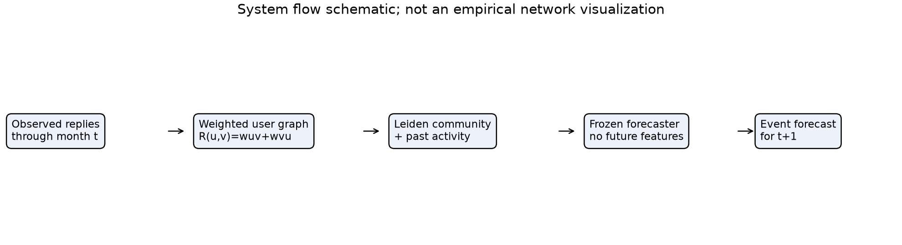

*Figure 1. Forecasting pipeline. Source: [executed study notebook](../notebooks/core/05_temporal_activity_study.ipynb).*

## 3. Dataset and feasibility

The observed collection comprises **15 subreddit corpora**: AskALiberal, AskThe_Donald, AskTrumpSupporters, Ask_Politics, Conservative, EnoughTrumpSpam, NeutralPolitics, PoliticalDiscussion, Political_Revolution, Republican, SandersForPresident, democrats, hillaryclinton, moderatepolitics, socialism. This is a topic-biased observational collection, not a representative sample of all Reddit. A user can participate in several subreddits; a subreddit is an activity context, not a ground-truth community label. The source documentation also warns that incomplete thread histories and duplicate processing entries can occur [1]. Our normalizer deduplicates record IDs, rejects inconsistent duplicates and records graph losses.

Across the study snapshots there are **18,567,881 comment records** before graph-event exclusions, **8,222–93,006 monthly reply endpoints**, and **27,221–693,866 unique undirected edges per month**. Comment records, account endpoints, edges and labeled community–months are different units; their counts must not be conflated. Parent records may predate the first study month and are retained for reply resolution rather than treated as extra forecast samples.

| Label-month partition | stable | grow | shrink | merge | split | dissolve | Total |
|---|---:|---:|---:|---:|---:|---:|---:|
| Training | 11 | 54 | 82 | 192 | 102 | 4854 | 5,295 |
| Validation | 1 | 14 | 18 | 22 | 25 | 846 | 926 |
| Final evaluation | 4 | 19 | 25 | 15 | 39 | 1167 | 1,269 |

Metadata are streamed into an indexed local store and graphs are processed month by month. We do not generate a quadratic clique among all users in a thread. Runtime stops enforce the declared 30 GiB working budget, 8 GiB sampled process-tree RSS ceiling and 12 GiB minimum free disk. The maximum RSS recorded in the original model-study phases is **1.08 GiB**; one-second monitoring can miss brief peaks. These measurements support feasibility on the observed collection, not unlimited scaling.

## 4. Network construction before forecasting

1. For each valid reply written in UTC month t, add a directed interaction from its author u to the parent author v. The parent timestamp must not exceed the reply timestamp. Count repeated replies as weight.
2. Exclude self-replies, invalid authors, missing parents and temporally invalid links from graph edges, recording the exclusions and coverage. Loss incidence counters may overlap and should not be summed as disjoint records.
3. Detect communities on the weighted undirected projection **R_t(u,v)=w_t(u,v)+w_t(v,u)**. A node is a pseudonymous account incident to a valid reply; accounts without a valid edge are counted separately.
4. Run independent weighted Leiden with the RB objective, resolution gamma=1 and canonical seed0 [3]. Seeds1/2 are measurement diagnostics, not additional independent datasets. Communities are detected independently each month and linked afterward.

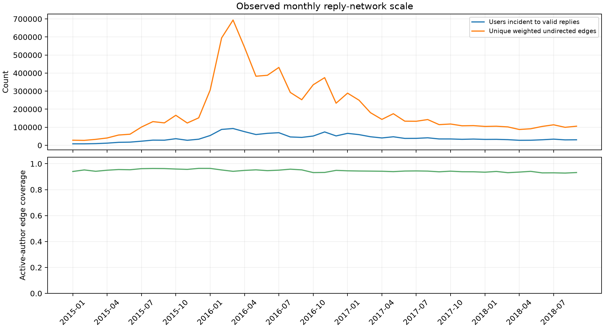

*Figure 2. Monthly network scale and reply coverage. Source: [study notebook](../notebooks/core/05_temporal_activity_study.ipynb).*

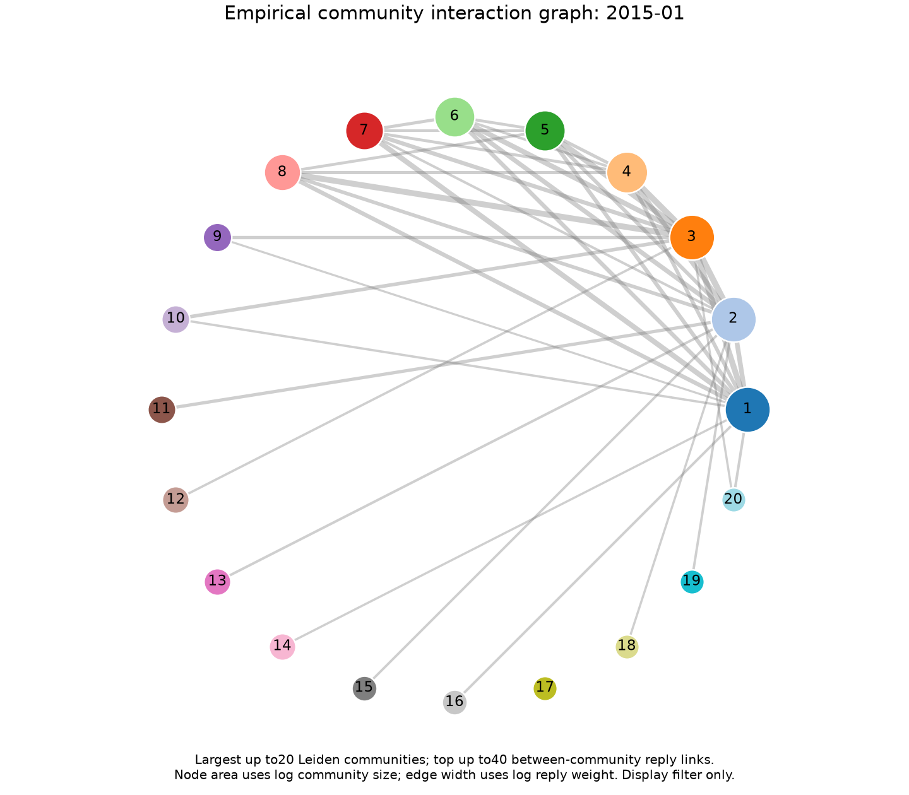

*Figure 3. Observed community interaction graph. Source: [study notebook](../notebooks/core/05_temporal_activity_study.ipynb).*

Figure 3 is a quotient graph of up to the twenty largest detected communities, showing up to forty strongest between-community reply links. The display filter does not remove communities, edges or samples from the experiment. It illustrates the measured network, not an independent validation of social groups.

## 5. Labels: definition, generation and validity

Reddit supplies **no native community-evolution class labels**. We create **GED-adapted operational pseudo-labels** using consecutive detected partitions [4]. For source A and successor B, weighted inclusion is

$$I(A,B)=\frac{|A\cap B|}{|A|}\frac{\sum_{u\in A\cap B}q_A(u)}{\sum_{u\in A}q_A(u)}.$$

Here q_A(u) is internal weighted degree, replaced by 1 if zero. A link is accepted if either directional inclusion reaches 0.5. This is our documented adaptation, not a claim to reproduce every original GED rule.

| Target | Exact operational rule |
|---|---|
| split | More than one accepted successor, without a many-to-many conflict |
| merge | One accepted successor with more than one accepted predecessor |
| grow / shrink / stable | One-to-one link; successor size is larger / smaller / equal |
| dissolve | No accepted link and no overlap with directional inclusion reaching 0.1 |
| unresolved, excluded from classification | Weak-overlap ambiguity or a many-to-many conflict |
| censored, not a class | Last snapshot has no observed successor month |

**Worked example, synthetic:** if two equally important four-person groups share three members, each directional inclusion is(3/4)×(3/4)=0.5625. A one-to-one link receives `stable` because sizes match, even though a member changed. Thus stable means equal observed size, not unchanged membership. Dissolve means loss of sufficient observed inclusion in the next monthly partition, not verified social disappearance. Section 11 audits later matches and member activity without changing this target. Forming is outside this source-community task because a newly born future community has no existing C_t to forecast from.

The audit records **11,562 source transitions with an observed next snapshot**, including **4,072 unresolved (35.22%)**. Classification results therefore apply to the **64.78%** with resolvable labels, not all detected transitions. Missing data, monthly aggregation and detector resolution may influence labels. Automated recomputation checks rule consistency; two-person blinded review forms exist, but **human annotation and agreement are still pending**. The labels are suitable for a clearly bounded structural forecasting experiment; their social validity remains unestablished.

Development-only sensitivity: threshold 0.4: 5/1,652 changed source-transition labels; threshold 0.6: 4/1,652 changed source-transition labels. On the measured development graph, gamma=0.5: ARI=0.501, gamma=1.5: ARI=0.403. These checks do not retune the forecast target or demonstrate robustness under every network construction. In particular, resolution sensitivity remains a limitation.

## 6. Evaluation plan and why each experiment exists

Training label months are February 2015–June 2017. Six expanding validation origins cover July–December 2017; each fit uses only earlier labels. After choosing settings, models are refitted through December 2017 and frozen before evaluating January–September 2018. Scalers and class weights learn only from training folds. There is no random row split and no model refitting on final labels [5].

**Primary metric:** Macro-F1 with a fixed six-class list and zero_division=0. We retain absent/rare classes in the metric and report per-class F1/support, confusion, monthly and size-stratum results. All methods predict identical sample keys, targets and dates. Three estimator seeds measure algorithm variability, not independent temporal replications.

| Experiment | Scientific purpose |
|---|---|
| B1 Majority and B2 Persistence | Establish frequency and temporal-repeatability reference levels |
| B3 Flat LR, same full features | Compare a separately tuned direct classifier using the same full inputs |
| B4 Hierarchical HGB static | Compare with the original strong champion already given current activity |
| B5 Hierarchical HGB dynamic | Test whether the proposed advantage survives a nonlinear model with the same full inputs |
| Proposed without D, settings fixed | Check the contribution of activity/interaction dynamics |
| Class, month, size and measurement diagnostics | Identify where the aggregate improvement does and does not hold |

The completed archived study used a broader **480 configuration–fold selection design**. This submission presents **five baseline roles, the original proposed model and one ablation** while retaining all archived configurations. For subsequent reruns, the compact forward protocol declares four tuned families, eight settings each and six validation origins: **192 configuration–fold evaluations**. Two-head models can fit two estimators per evaluation. Majority and Persistence have fixed rules, and the ablation reuses primary settings. The compact budget is not retroactively claimed for the completed study; no new search was performed on its final outcomes.

The submitted seven-configuration view is a retrospective reduction of a completed broader study. The original primary, predictions, validation champion and full archived results are retained. HGB dynamic was an alternative architecture in that study and is now explicitly treated as a strong nonlinear reference. This role change is disclosed; it is not a new preregistered comparison or an independent rerun.

The original validation champion remains **hier_hgb_static**. A paired moving-block bootstrap uses three-month blocks,2,000 draws and a fixed seed, following the time-block resampling principle [8], with pooled confusion matrices and mean-over-seed F1 differences. The nine-month interval is exploratory. We additionally compute the same descriptive contrast against the stronger expanded reference, clearly distinguishing it from the original frozen primary comparison. Past post-2015 outcome exposure has not been independently certified; the chronology alone does not establish an untouched confirmation set.

## 7. Proposed method and relation to prior work

Feature groups are **S**(current structure), **H**(community history), **L**(known predecessor state), **C**(subreddit activity context), **A**(current member activity/replies) and **D**(past activity and interaction dynamics). Static uses S+H+L+C+A; dynamic adds D. D includes returning-member fraction, observed active-month fraction, log changes in records and internal replies, repeated dyads and subreddit-distribution drift. Empty or missing histories carry explicit flags; missing observations are not proof of inactivity.

The proposed **hierarchical Logistic Regression with dynamics** first predicts P(dissolve). A second Logistic Regression predicts the other five classes conditional on non-dissolution. Composition uses P(event)=(1−P(dissolve))P(event|non-dissolve), with an explicit dissolve probability and fixed-class argmax. Single-class or empty-conditional training folds use documented training-only fallbacks. The selected primary setting is **estimator=lr, C=1.0, class_weight=balanced, transform=standard**; model outputs are not claimed to be calibrated.

The two-stage design is motivated by a common observed low-inclusion event and heterogeneous surviving-community transitions. It is still evaluated against the same-input flat LR and nonlinear hierarchical controls, rather than assumed to help. The no-D ablation fixes selected primary settings; it measures that fitted design's dependence on D, not the best possible independently retuned static LR.

GED provides the structural-event framework [4]. Prior work already predicts community evolution from historical states [6]. We therefore claim an implemented and measured activity/interaction feature design on this observed Reddit task, **not invention of community-evolution prediction, a complete HeTCo implementation, or established methodological novelty**. More complex representation models are future comparators, not methods already reproduced here.

## 8. Measured results and interpretation

| Method | Six-class Macro-F1, mean of three seeds | Why it is included |
|---|---:|---|
| B1 Majority | 0.1597 | Most frequent training label; minimum sanity check |
| B2 Persistence | 0.1562 | Known predecessor event; training-majority fallback |
| B3 Flat LR + dynamics | 0.3616 | Same full inputs, separately tuned direct six-class classifier |
| B4 Hierarchical HGB static | 0.3728 | Strong original validation champion; already includes current activity |
| B5 Hierarchical HGB + dynamics | 0.3880 | Same full inputs and hierarchy; strong nonlinear reference |
| Proposed hierarchical LR + dynamics | 0.4117 | Two-stage linear forecast with interpretable past-activity features |
| Ablation: proposed without D | 0.3643 | Same selected primary settings, removing dynamic features only |

The frozen proposed model exceeds the strongest reported baseline **hier_hgb_dynamic** by **+0.0237**. Against the original validation champion, its difference is **+0.0390**, with 95% paired interval **[+0.0056, +0.0744]**. The secondary strongest-reference interval is **[-0.0828, +0.0984]**; its automatic descriptive criterion is **not_demonstrated**. A higher point estimate alone must not be described as confirmed superiority if this interval includes zero. These are preliminary observed-cohort results with rule-derived labels.

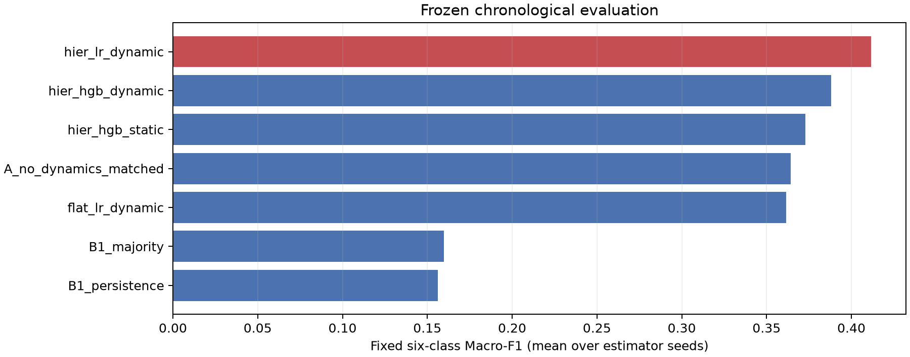

*Figure 4. Five baselines, proposed and ablation. Source: [executed study notebook](../notebooks/core/05_temporal_activity_study.ipynb).*

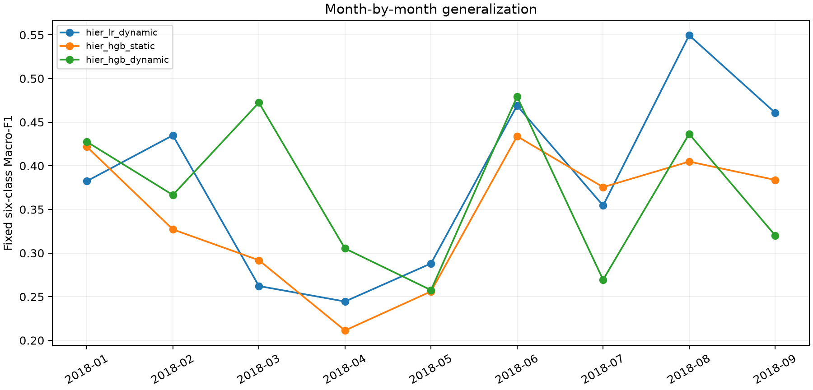

*Figure 5. Monthly generalization. Source: [study notebook](../notebooks/core/05_temporal_activity_study.ipynb).*

The proposed method wins **5/9** observed months against the strongest expanded reference. It is not uniformly superior over time.

### 8.1. Rare classes and errors

| Event | Final support | Proposed F1, mean seeds | Strongest-reference F1, mean seeds |
|---|---:|---:|---:|
| stable | 4 | 0.0000 | 0.0000 |
| grow | 19 | 0.0968 | 0.1277 |
| shrink | 25 | 0.4444 | 0.4667 |
| merge | 15 | 0.2308 | 0.1132 |
| split | 39 | 0.7397 | 0.6567 |
| dissolve | 1167 | 0.9587 | 0.9640 |

Dissolve accounts for **91.96%** of final samples. Stable has only **4** final cases. The headline metric must therefore be read with the class table: the current system cannot be presented as reliably forecasting all six events. Better aggregate performance does not resolve rare-class validity or guarantee useful forecasts for growth/stability.

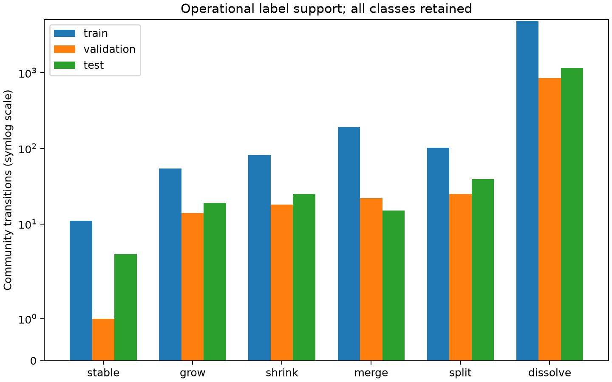

*Figure 6. Class support by temporal split. Source: [study notebook](../notebooks/core/05_temporal_activity_study.ipynb).*

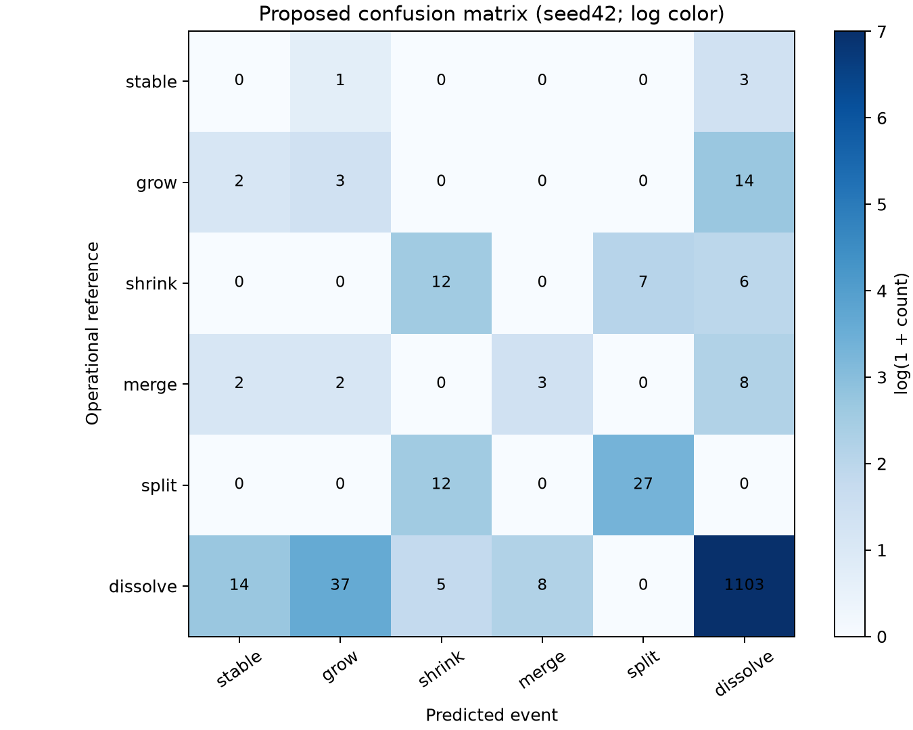

*Figure 7. Proposed confusion matrix, seed42. Source: [study notebook](../notebooks/core/05_temporal_activity_study.ipynb).*

### 8.2. Component and size diagnostics

The component comparisons answer different questions and must not be conflated:

| Original-cohort comparison | Six-class Macro-F1 | Interpretation |
|---|---:|---|
| Proposed hierarchy with D | 0.4117 | Primary configuration |
| Proposed hierarchy without D | 0.3643 | Remove dynamics at fixed primary settings |
| Archived matched flat LR | 0.3321 | Same fields and settings, without the hierarchy |
| Separately tuned flat LR baseline | 0.3616 | Competing direct classifier with its own selected settings |

The matched-flat result is a retrospective auxiliary diagnostic from saved predictions, not an additional baseline or a newly fitted model. It supports investigating the hierarchy on this cohort. The no-D comparison supports investigating dynamics here, while the external cohort in Section 10 shows that this contribution does not generalize uniformly. Neither contrast establishes social causality or a separately significance-tested component effect.

| Source-community size | Proposed Macro-F1 | Strongest-reference Macro-F1 |
|---|---:|---:|
| 2 or fewer members | 0.2078 | 0.1967 |
| 3–9 members | 0.2396 | 0.2148 |
| 10 or more members | 0.3474 | 0.3414 |

Each size bucket retains the fixed six-class metric, so class absence and composition affect its score. Size-stratum results are descriptive, not independent validation datasets. No small-community exclusion was introduced to improve the headline result.

## 9. Prototype, reproducibility and midterm status

The runnable path is **raw archives → normalized metadata → monthly graphs → Leiden partitions → audited event labels → causal features → temporal selection/freeze → prediction/evaluation → report/notebook**. The CLI stages are normalize-development, develop, select, evaluate and report. Completed stages carry hashes; incomplete/failed attempts are retained, and verified completed months can be resumed. The evaluation gate rejects source/config/model drift after selection. Historical run readers validate saved targets, probability vectors and metrics without loading model pickles.

The [executed notebook](../notebooks/core/05_temporal_activity_study.ipynb) contains code, saved metric output and all thirteen figures. [README](../README.md) and the [runbook](../docs/RUNBOOK.md) document environment and execution. A fresh checkout needs the documented raw data/environment and either a completed local run or an explicit new run; saved GitHub notebook output is a static evidence snapshot, not a hosted executable service.

| Midterm 1 deliverable | Evidence available | Location |
|---|---|---|
| Detailed experimental plan and experiment list | Problem, RQs, exact input/output, graph/label construction, temporal split, five baseline roles and fixed comparisons | Sections 1–7 |
| Baseline method results | Five baseline configurations evaluated on identical community–month targets | Sections 8 and 10 |
| Preliminary proposed method results | Executed two-stage LR, probability outputs, scores, class errors and ablation | Sections 7, 8 and 10 |
| Basic baseline–proposed comparison | Strongest-baseline point comparison, paired uncertainty, component, temporal and size diagnostics | Sections 8, 10 and 11 |
| Prototype demonstration | CLI from raw input to results and executed notebook with thirteen embedded figures | This section and the linked notebook |

All five requested submission components are available. The proposed method has a positive point advantage over the strongest of the five baselines in both cohorts: **+0.0237** in the original cohort and **+0.0190** in the external cohort. These are preliminary midterm findings. Demonstrating a stable advantage, independently validating social labels and establishing methodological novelty are subsequent research questions, not completed claims.

**Original-study follow-up priorities (the evidence below updates their status):** independently review a blinded sample spanning all event classes and unresolved cases, report agreement/adjudication and investigate detector/target errors; establish a new genuinely unexposed confirmation cohort before further model selection; examine rare-event support and monthly-resolution sensitivity on development data; then evaluate additional architectures only against the same audited task. Any change to label semantics or eligibility creates a new versioned target and requires a new evaluation, not a replacement of these results.

The Midterm 1 contribution is a functioning research prototype, a reproducible measurement definition and measured preliminary comparisons. Sections 10 and 11 use additional evidence to identify where target interpretation and generalization need further work. Independent human label validation, dependable rare-event performance and confirmed novelty remain future research milestones.

## 10. Target checks and locked external-corpus replication

### 10.1. Structural assessments and provenance

Two separate automated assessments were supplied with blinded structural summaries, without machine labels, model predictions or the other assessment's judgments. The summaries include source/target sizes, all overlapping successor groups, retained-member/importance proportions and up to five largest predecessors per successor. Truncation is disclosed and original membership evidence stays local. The assessment rubric allows unresolved cases rather than forcing agreement with the tracker.

| Panel | Cases | Assessment source | Raw agreement | Unweighted Cohen kappa |
|---|---:|---|---:|---:|
| development | 35 | automated | 0.971 | 0.959 |
| final | 34 | automated | 0.941 | 0.918 |

Tracker discrepancies are retained: development: 19/35 first-assessment and 19/35 second-assessment disagreements with the tracker; final: 19/34 first-assessment and 20/34 second-assessment disagreements with the tracker. Agreement between assessments does not establish agreement with the operational labeling rule.

These are **supplementary automated checks**, not two independent human annotations, adjudicated truth or social validation. Shared model priors may inflate agreement. Human review remains pending. Disagreements with each other and the tracker are retained; no automatic adjudicator replaces the target labels. The stratified sample is diagnostic and cannot estimate event prevalence. Missing or incomplete submissions cannot produce a completed-review status.

The large tracker-disagreement counts are a measurement warning, not a validated tracker error rate. The blinded plausibility rubric allows roughly unchanged size and ambiguous lineage, whereas the machine target uses exact equal size, weighted inclusion and deterministic branch precedence. Semantic differences and detector errors require separate investigation. Agreement between two automated assessments cannot resolve this discrepancy; genuine independent human review and development-only target-policy decisions remain necessary.

### 10.2. External cohort and fixed design

The separate cohort comprises AustralianPolitics, CanadaPolitics and ukpolitics from the official [ConvoKit catalogue](https://convokit.cornell.edu/documentation/subreddit.html). Corpus names, dates, original selected settings, five baseline roles, proposed method, ablation and uncertainty rules were declared before new forecast labels were prepared. SHA256 and full ZIP CRC identify the acquired archives. This is external-corpus replication; users may overlap and earlier group exposure is uncertified.

The three archives total 1,438,928,369 compressed bytes and contain 9,329,646 raw records. Cutoff normalization retains 6,727,214 records before 2018 and adds 2,323,356 before October 2018. These are records, not independent prediction samples: the declared monthly graph/target procedure yields 975 development and 286 final eligible community transitions. Larger raw volume therefore does not guarantee stronger rare-event evidence.

The four monitored acquisition/development/fitting/evaluation phases total 35.64 minutes, with a highest sampled process-tree RSS of 0.55 GiB and working inventory of 5.54 GiB. RSS is sampled once per second, so brief peaks may be missed. These measurements describe this external-cohort run and machine, not a universal performance bound.

Models were refitted using only new-cohort labels before January 2018, with **no new hyperparameter search**. The complete source, protocol, new development samples and fitted models were frozen before preparing January–September 2018 target partitions. The new context entropy denominator is log(3), declared for three corpora; the original log(15) default is preserved. Separate reference IDs prevent pooling different cohort targets.

The experiment retains its archived source. A later compatibility correction compares corpus names as a set, allowing the historical fifteen-corpus list to be stored in sorted order. Recomputing with archived and corrected extractors produced byte-identical features, labels, samples, tracking and inclusion tables. No models were refitted or settings changed. The original freeze remains unchanged and rejects further evaluation under modified source.

| Configuration | Original Macro-F1 | External Macro-F1 |
|---|---:|---:|
| B1_majority | 0.1597 | 0.1555 |
| B1_persistence | 0.1562 | 0.1550 |
| flat_lr_dynamic | 0.3616 | 0.3451 |
| hier_hgb_static | 0.3728 | 0.2900 |
| hier_hgb_dynamic | 0.3880 | 0.3500 |
| hier_lr_dynamic | 0.4117 | 0.3690 |
| A_no_dynamics_matched | 0.3643 | 0.3777 |

The predeclared external comparator is **hier_hgb_dynamic**, chosen from prior inspected evidence, not from new final outcomes. Proposed minus that comparator is **+0.0190**, with 95% paired three-month-block interval **[-0.2631, +0.2101]**. The declared criterion returns **not_demonstrated**. The strongest realized external baseline is **hier_hgb_dynamic**, with point difference **+0.0190**. Retrospective and external scores describe different targets; compare methods within a cohort rather than claiming a cross-cohort score increase is a model improvement.

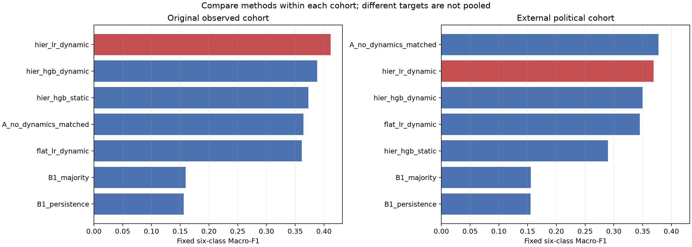

*Figure 8. Separate cohort comparisons. Source: [executed notebook](../notebooks/core/05_temporal_activity_study.ipynb).*

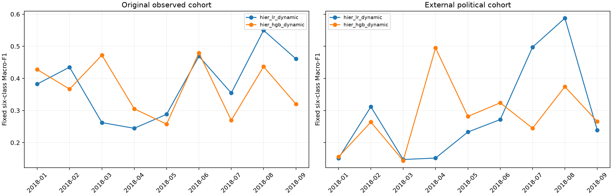

*Figure 9. Temporal replication. Source: [executed notebook](../notebooks/core/05_temporal_activity_study.ipynb).*

The matched no-dynamics control scores **0.3777**, versus **0.3690** for the frozen primary. The contribution of dynamics therefore remains cohort-dependent; a positive comparison with named baselines alone cannot establish the proposed mechanism. This final-period observation does not authorize replacing the primary or retuning the same confirmation set.

### 10.3. Rare classes and unresolved coverage remain measured outcomes

| Final cohort | stable | grow | shrink | merge | split | dissolve | Total |
|---|---:|---:|---:|---:|---:|---:|---:|
| Original | 4 | 19 | 25 | 15 | 39 | 1167 | 1269 |
| External | 1 | 8 | 14 | 9 | 4 | 250 | 286 |

The external final period has **477** transitions with an observed successor, **286** with resolvable six-class labels, and **191** unresolved. The 39 final-snapshot communities without a later observed month are censored separately. Coverage, size strata and every unresolved reason remain in the audited record. No oversampling, small-community exclusion or forced weak-overlap label increases final support.

| External period | Observed transitions | Resolved | Unresolved | Censored |
|---|---:|---:|---:|---:|
| Training | 1358 | 720 | 638 | 0 |
| Validation | 401 | 255 | 146 | 0 |
| Final | 477 | 286 | 191 | 39 |

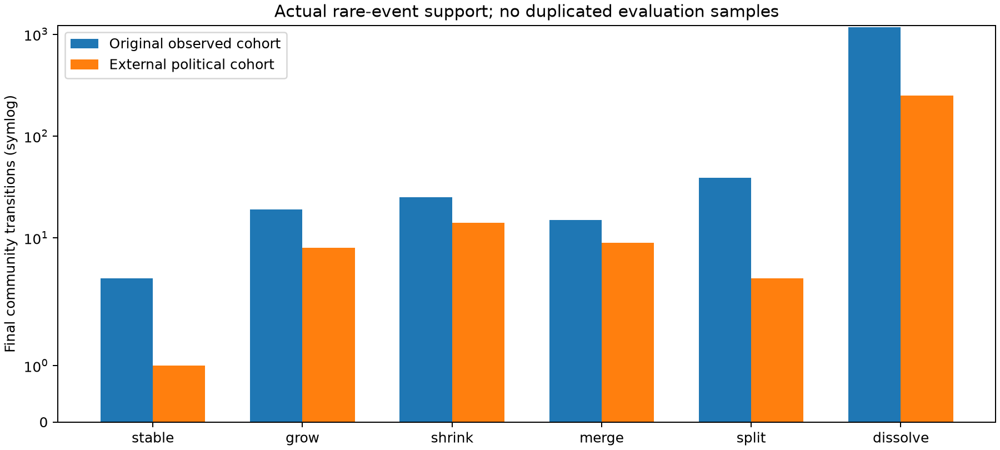

*Figure 10. Actual final-class counts. Source: [executed notebook](../notebooks/core/05_temporal_activity_study.ipynb).*

Exact-size stability is a restrictive operational definition. Development-only near-stability diagnostics describe alternative 0%, 5% and 10% size tolerances without replacing original labels or choosing a threshold by final Macro-F1. A revised event policy would be a new measurement target requiring separate validation. A larger corpus does not guarantee adequate support for every class; sparse classes and a confidence interval including zero remain explicit limitations.

Among 73 external development one-to-one transitions, 3 have exactly equal size, 3 differ by at most 5%, and 3 by at most 10%. These nested diagnostic counts are not additional evaluation cases.

The new evidence addresses measurement transparency and replication. It does not by itself establish human target validity, dependable rare-event prediction, universal superiority or paper-level novelty.

## 11. Longitudinal observability: what does disappearance mean?

A one-month absence is insufficient evidence that a social group has died. We therefore audited the fixed source membership at t against the independently detected partitions at t+1, t+2 and t+3. This diagnostic uses only January 2015–December 2017 development observations in each cohort. No 2018 memberships, final labels or evaluation stores enter the longitudinal audit. The original six-class labels, features, model selection and held-out predictions remain unchanged.

A candidate match passes the existing weighted GED inclusion threshold in either direction (0.5). Matching is direct from the same C_t to each later partition, not an assertion of identity propagated through a lineage. Multiple matches and merge candidates remain explicit. No accepted match means no observed accepted membership match in the acquired corpora, **not confirmed social death**.

| Development cohort | Source groups | Complete 3-month windows | Next-month match | Later-only candidate | No match in complete window | Censored | Coverage unknown |
|---|---:|---:|---:|---:|---:|---:|---:|
| Original | 9946 | 3922 | 199 | 81 | 3642 | 650 | 5374 |
| External | 1796 | 1652 | 134 | 75 | 1443 | 144 | 0 |

For the specific one-month disappearance concern:

- Original: 20/2450 fully observed source groups originally labeled dissolve have a later accepted match candidate at month 2 or 3.
- External: 12/781 fully observed source groups originally labeled dissolve have a later accepted match candidate at month 2 or 3.

Complete three-month follow-up requires t no later than September 2017. Later source groups remain in the censored denominator. A missing month or an acquired corpus with zero records makes coverage unknown; zero records do not establish absence. Zero-record cells may reflect genuine inactivity or unmeasured coverage; this conservative flag does not distinguish the two. Counts are also retained by month, source size, original label and reason. These overlapping strata are not additional independent observations.

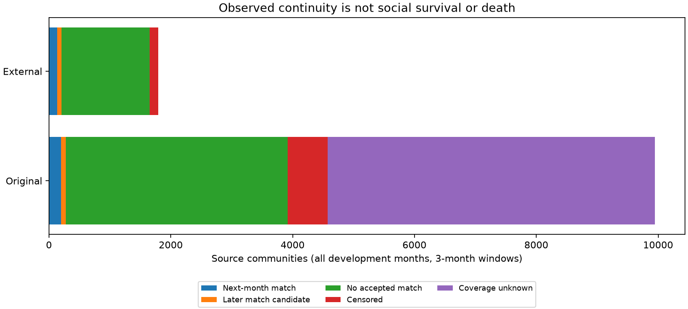

*Figure 11. Development follow-up. Source: [executed notebook](../notebooks/core/05_temporal_activity_study.ipynb).*

### 11.1. Member activity and network visibility are different

Authored activity includes posts and comments written by former members in the target month. Reply-endpoint observation may include a parent author whose post is older. Only users incident to a valid reply enter the detected partition. A member can therefore remain active while lacking an accepted community match. All fractions use the original source membership as denominator and only the acquired corpus scope.

| Cohort | Observed next-month dissolve cases | Mean authored-member fraction | Mean reply-endpoint fraction |
|---|---:|---:|---:|
| Original | 2723 | 0.068 | 0.056 |
| External | 838 | 0.098 | 0.094 |

These are means across communities, not a pooled unique-user rate. The observation window and activity-channel distinction qualify the interpretation of dissolve; they do not automatically relabel any forecast case.

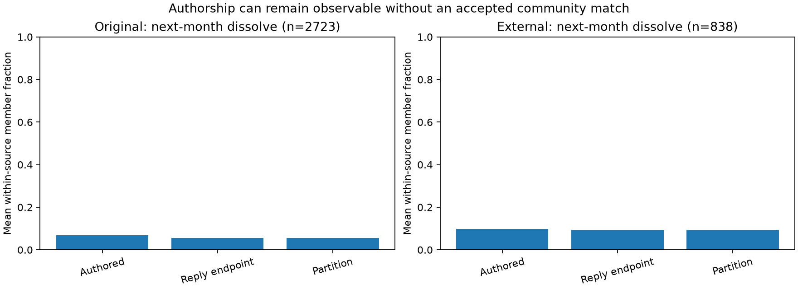

*Figure 12. Observed member activity. Source: [executed notebook](../notebooks/core/05_temporal_activity_study.ipynb).*

### 11.2. Detection repeatability and matched architecture evidence

Saved seed0/1/2 partitions were compared on identical monthly node universes and their pairwise ARI values recomputed. Undefined values remain undefined. Repeatability measures sensitivity to random initialization, **not accuracy against social ground truth**.

Across the 36 development months, mean pairwise ARI is **0.942** in the original cohort and **0.600** in the external cohort (108 and 108 defined seed pairs). The external partitions are substantially less repeatable under initialization. This is a concrete measurement limitation for that replication; it does not establish the cause of its forecast errors or justify selecting a better-looking seed. Canonical seed0 remains unchanged.

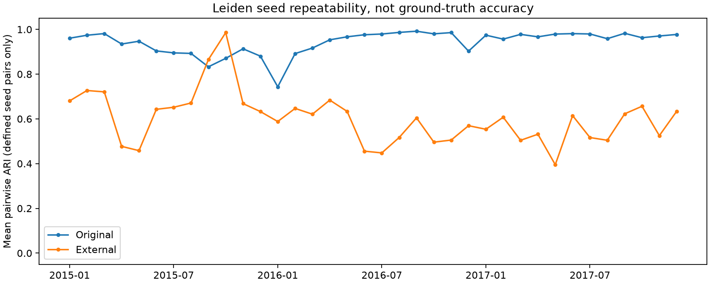

*Figure 13. Leiden seed repeatability. Source: [executed notebook](../notebooks/core/05_temporal_activity_study.ipynb).*

Separately from this development-only audit, an already archived original-cohort held-out matched-flat control scores **0.3321**, versus **0.4117** for the hierarchical primary. Feature fields, estimator settings and case keys match; the hierarchy differs. This is a **retrospective auxiliary architecture diagnostic**, not a sixth baseline, a new fit or independent confirmation. The external cohort did not save this matched-flat control, so its architecture comparison is unavailable.

### 11.3. Research decision

The prototype currently forecasts **operational next-month structural transitions**. It does not establish permanent community death or independently validated social labels. The longitudinal findings constrain interpretation before model improvement: verify whether gap cases arise from observation loss, changing membership or detector instability. Human review remains pending. Automated consistency is supplementary.

The original primary has the highest point Macro-F1 among the five named baselines in both cohorts, but the paired interval against the strongest comparator contains zero. The no-dynamics control also beats the primary in the external cohort. Thus neither robust superiority nor a general dynamics mechanism has been established. Do not retune or replace the primary using these final outcomes.

If the intended claim is sustained disappearance rather than a next-month transition, a future target must be versioned with explicit follow-up availability, ambiguous/censored cases and whole-month train/validation separation that accounts for the longer horizon. That is a new evaluation task, not a reinterpretation of the existing scores. The next defensible step is actual human measurement review followed by a separately declared development design and a new untouched evaluation period.

Observed audit resources (one-second sampled process-tree RSS; brief peaks may be missed):

- Original: 12.75 minutes, peak sampled RSS 4.00 GiB. No new download or model fit was required.
- External: 4.76 minutes, peak sampled RSS 1.34 GiB. No new download or model fit was required.

## References

[1] CornellNLP, “Reddit Corpus (by subreddit),” ConvoKit documentation. [Online]. Available: [corpus documentation](https://convokit.cornell.edu/documentation/subreddit.html).

[2] J. Baumgartner et al., “The Pushshift Reddit Dataset,” Proceedings of ICWSM, vol.14, pp.830–839,2020. [doi:10.1609/icwsm.v14i1.7347](https://doi.org/10.1609/icwsm.v14i1.7347).

[3] V. A. Traag, L. Waltman, and N. J. van Eck, “From Louvain to Leiden: Guaranteeing well-connected communities,” Scientific Reports, vol.9, Art.5233,2019. [doi:10.1038/s41598-019-41695-z](https://doi.org/10.1038/s41598-019-41695-z).

[4] P. Bródka, S. Saganowski, and P. Kazienko, “GED: The method for group evolution discovery in social networks,” Social Network Analysis and Mining, vol.3, pp.1–14,2013. [doi:10.1007/s13278-012-0058-8](https://doi.org/10.1007/s13278-012-0058-8).

[5] Scikit-learn developers, “Cross-validation: Evaluating estimator performance.” [Online]. Available: [documentation](https://scikit-learn.org/stable/modules/cross_validation.html).

[6] S. Saganowski et al., “Predicting Community Evolution in Social Networks,” Entropy, vol.17, pp.3053–3096,2015. [doi:10.3390/e17053053](https://doi.org/10.3390/e17053053).

[7] J. P. Chang et al., “ConvoKit: A Toolkit for the Analysis of Conversations,” Proceedings of SIGDIAL,2020. [Paper](https://www.cs.cornell.edu/~cristian/ConvoKit_Demo_Paper_files/convokit-demo-paper.pdf).

[8] H. R. Künsch, “The Jackknife and the Bootstrap for General Stationary Observations,” The Annals of Statistics, vol.17, no.3, pp.1217–1241,1989. [doi:10.1214/aos/1176347265](https://doi.org/10.1214/aos/1176347265).
